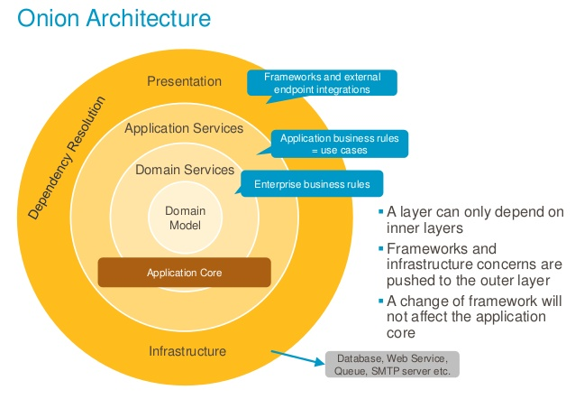
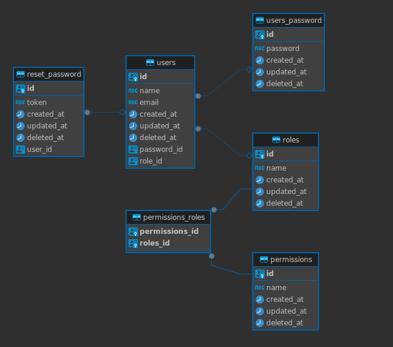

<div align="center">
  <h1>🚀 NestJS Microservice Boilerplate API</h1>
  <p><strong>Enterprise-grade, production-ready NestJS boilerplate with modern architecture patterns</strong></p>

[![Node.js Version][node-image]][node-url]
[](https://www.typescriptlang.org/)
[](https://nestjs.com/)
[](https://opensource.org/licenses/MIT)

[node-image]: https://img.shields.io/badge/node.js-%3E=_22.0.0-green.svg?style=flat-square
[node-url]: http://nodejs.org/download/

  <h3>Code Coverage</h3>

| Statements                                                                               | Branches                                                                             | Functions                                                                              | Lines                                                                          |
| ---------------------------------------------------------------------------------------- | ------------------------------------------------------------------------------------ | -------------------------------------------------------------------------------------- | ------------------------------------------------------------------------------ |
|  |  |  |  |

</div>

---

## A Complete, Production-Ready Foundation

This repository ships the application together with everything needed to run
it in a real environment: databases, caching, observability, AWS
infrastructure, Kubernetes platform, GitOps delivery, and operational workflows.

The infrastructure is defined as code with Pulumi and deploys to AWS using
Amazon EKS, Karpenter, Argo CD, and Kubernetes. It also includes secure secret
integration, health checks, automated database migrations before application
rollouts, autoscaling, persistence, and monitoring.

Before using it in a specific environment, review the AWS account permissions,
network topology, security policies, domains, observability retention, backup
strategy, sizing, and environment-specific configuration.

For infrastructure setup and deployment instructions, see the
[Infrastructure as Code README](IaC/README.md).

## Table of Contents

- [Architecture Overview](#architecture-overview)
- [Architectural Identity](#architectural-identity)
- [The Pragmatic Principle](#the-pragmatic-principle)
- [Architecture Comparison](#architecture-comparison)
- [Design Decisions](#design-decisions)
- [Interface Naming Taxonomy](#interface-naming-taxonomy)
- [What to Avoid in Core](#what-to-avoid-in-core)
- [Entities, Sub-entities, and Value Objects](#entities-sub-entities-and-value-objects)
- [Layer Communication Rules](#layer-communication-rules)
- [Project Structure](#project-structure)
- [Quick Start](#quick-start)
- [User Flow](#user-flow)
- [Documentation Guides](#documentation-guides)
- [Key Features](#key-features)
- [Tech Stack](#tech-stack)
- [Contributing](#contributing)
- [License](#license)

---

## Architecture Overview

This project combines ideas from Clean Architecture, Onion Architecture, Domain-Driven Design (DDD), and Hexagonal Architecture without strictly following any of them. It aims to be **powerful enough for enterprise applications, yet simple enough for any developer to understand and maintain**.

### The Core Philosophy

The architecture is built around one fundamental principle: **protect your business logic**. Your domain rules should never depend on frameworks, databases, or external services. If you decide to switch from PostgreSQL to MongoDB, or from Redis to Memcached, your core business logic remains untouched.



---

## Architectural Identity

Where the classical patterns do not pay for their cost, this project makes its own decisions. Every deviation is deliberate and documented.

### What This Project Is Not

- A textbook implementation of Clean Architecture
- A strict DDD codebase with separate `value-objects/` and `aggregates/` folders
- A classical Hexagonal implementation with Ports and Adapters as separate concepts

### The Decisions That Define This Project

| Decision                   | Classical pattern says                                      | This project does                                                                                        | Why                                                                                                 |
| -------------------------- | ----------------------------------------------------------- | -------------------------------------------------------------------------------------------------------- | --------------------------------------------------------------------------------------------------- |
| Where "Adapter" lives      | On the implementation class                                 | On the contract (interface)                                                                              | The class has no identity without the contract                                                      |
| Validation location        | Controller / Validator layer                                | Use Case (via `@ValidateSchema`)                                                                         | Validation is business logic; must be unit-testable                                                 |
| Service layer              | Domain Service + Application Service                        | Unified in `UseCase`                                                                                     | The split adds boilerplate without benefit here                                                     |
| Value Objects              | Separate classes in `value-objects/`, even without behavior | Live in `entity/{domain}-{subdomain}.ts`, extend `BaseValueObject`, **only when the value has behavior** | The Zod schema already covers validation; the base class and the `ValueObject` suffix mark the role |
| Aggregates                 | Separate `aggregates/` folder                               | The root entity **is** the aggregate                                                                     | One less folder; the root entity encapsulates the cluster                                           |
| Repository contract        | Interface                                                   | Abstract class                                                                                           | NestJS DI needs runtime tokens                                                                      |
| Interface naming           | Port / Adapter                                              | `I*Adapter` / `I*Repository` / `I{Domain}{Operation}`                                                    | Each suffix declares architectural role                                                             |
| `middlewares/` folder      | Split by concern                                            | Unified                                                                                                  | No better name found; all wrap HTTP lifecycle                                                       |
| External libraries in Core | Never                                                       | Zod allowed (conscious exception)                                                                        | Solves validation + types + mocks in one dependency                                                 |

### The Unifying Criterion

Every decision above follows the [Pragmatic Principle](#the-pragmatic-principle), described in the next section. If a decision cannot be justified by it, it does not belong in this project.

### How to Disagree

If you believe a decision is wrong, the README gives you the criteria to argue against it:

- The **declared position** and its **justification** are in the table above.
- The **conditions for revisiting** a decision are in [When Exceptions Become the Rule](#when-exceptions-become-the-rule).

That is the difference between a boilerplate and a dogma.

---

## The Pragmatic Principle

This architecture follows a simple rule: **optimize for what happens most, treat what happens least as an explicit, named exception.**

We do not change a pattern because of a case that "almost never happens." We simplify for the common path, and we handle the rare path with a documented, adapted exception — not by ignoring it, and not by over-engineering for it.

This means:

- The **common case** is light: no ceremony that does not pay for itself.
- The **rare case** is explicit: it has a name, a place, and a documented workaround.
- The **boundary** is monitored: if an exception grows beyond a threshold, it stops being an exception and the architecture is revisited.

**Examples in this project:**

| Decision                   | Common case (optimized)                              | Rare case (explicit exception)                                     |
| -------------------------- | ---------------------------------------------------- | ------------------------------------------------------------------ |
| Validation                 | Business rules inside Use Case via `@ValidateSchema` | Transport format (query, sort, pagination) validated in Controller |
| Entities                   | Single root entity per domain                        | Sub-entities and Value Objects in `{domain}-{subdomain}.ts`        |
| Value Objects              | Field validated by the Zod schema + `InferSchema`    | `BaseValueObject` when the value has behavior of its own           |
| `any`                      | Never used                                           | `eslint-disable` with justification comment                        |
| External libraries in Core | Avoided                                              | Zod is a conscious exception (see below)                           |
| Domain Services            | Logic in Entity or Use Case                          | — (not needed in this architecture)                                |

The patterns are guides, not mandates.

### When Exceptions Become the Rule

"Explicit exception" only works if you measure when the exception stops being an exception. These are the signals we watch:

| Signal                                              | Suggested threshold | Action                                               |
| --------------------------------------------------- | ------------------- | ---------------------------------------------------- |
| Use Cases validating transport in Controller        | > 20% of Use Cases  | Revisit whether validation should leave the Use Case |
| Sub-entities with their own repository              | > 10% of domains    | Introduce a Unit of Work pattern                     |
| `any` with `eslint-disable`                         | > 5 occurrences     | Revisit typing or create a wrapper                   |
| `I*Adapter` interfaces with a single implementation | > 6 months          | Evaluate whether the contract is premature           |
| External libraries in Core                          | > 1 (currently Zod) | Require an ADR for each addition                     |
| Same helper function around a schema field          | > 2 Use Cases       | Move the behavior into a Value Object                |

**The principle:** an exception is allowed, but it must be **visible**. If a threshold is crossed, the architecture is revisited — not silently patched.

---

## Architecture Comparison

### Clean Architecture

Clean Architecture organizes code into concentric circles where dependencies point inward. The innermost circle contains business rules, and outer circles contain implementation details.

**How we implement it:**

- **Entities** live in `src/core/*/entity` — pure business objects
- **Use Cases** live in `src/core/*/use-cases` — application-specific business rules
- **Interfaces** live in `src/core/*/repository` — contracts for external dependencies
- **Frameworks** live in `src/modules` and `src/infra` — NestJS controllers and database implementations

**What we simplified:**

- No explicit Interactors or Presenters
- No input/output boundary classes

### Onion Architecture

[Onion Architecture](https://jeffreypalermo.com/2008/07/the-onion-architecture-part-1/) was proposed by Jeffrey Palermo in 2008. The Domain Model sits at the center, surrounded by the **Application Core**, and infrastructure lives on the outer edge. All coupling points toward the center.

**How we implement it:**

- **The `core/` folder is the Application Core.** The name comes from Palermo: it holds the domain model and the contracts, and nothing in it depends on the outside.
- **Repository interfaces live in the core, implementations live at the edge.** `core/*/repository` declares the contracts; `modules/` and `infra/` implement them. This is the central point of Onion: only the interface belongs to the core, because saving objects involves a database.
- **The database is external.** The application uses a database through an implementation of a core contract; it is not built around it.

**What we simplified:**

- **No Domain Services and Application Services layers inside the core.** Palermo's core has both around the Domain Model. We unify them in the `UseCase` (see [Service Layer Comparison](#service-layer-comparison-ddd-vs-this-architecture)), for the same reason we do it for DDD: the boundary between them is blurry and does not change the code.

### Domain-Driven Design (DDD)

DDD focuses on modeling your business domain. It introduces concepts like Entities, Value Objects, Aggregates, and Repositories.

**How we implement it:**

- **Entities**: Objects with identity that persist over time (`UserEntity`, `RoleEntity`)
- **Repository Pattern**: Abstract interfaces defining data access contracts
- **Use Cases**: Encapsulate business operations (similar to Application Services in DDD)
- **Bounded Contexts**: Each module represents a bounded context

**What we simplified:**

- **No separate `value-objects/` or `aggregates/` folders** — everything lives in `entity/`
- **The root entity is the aggregate** — no separate `AggregateRoot` class
- **Unified service layer** (no Domain/Application Service split)

#### Service Layer Comparison: DDD vs. This Architecture

In traditional DDD, there are two types of services:

- **Domain Service:** Encapsulates domain logic that does not naturally fit within an Entity or Value Object.
- **Application Service:** Coordinates use cases, orchestrating entities, repositories, and domain services to fulfill business processes.

**In this architecture, both responsibilities are unified into a single component: the `UseCase`.**

- The `UseCase` acts as the application service, orchestrating business operations and dependencies.
- Domain logic that would be placed in a domain service is either implemented within entities or directly in the use case, depending on complexity.

This simplification reduces boilerplate and cognitive overhead, while still maintaining a clear separation between business logic and infrastructure. The result is a leaner, more maintainable service layer without sacrificing the core benefits of DDD.

### Hexagonal Architecture (Ports and Adapters)

Hexagonal Architecture separates the application from external concerns through Ports (interfaces) and Adapters (implementations).

**How we implement it:**

```
┌──────────────────────────────────────────────────────────────┐
│                        ADAPTERS                              │
│  ┌─────────────┐  ┌─────────────┐  ┌─────────────────────┐   │
│  │ Controllers │  │ Repositories│  │ External Services   │   │
│  │ (modules/)  │  │ (modules/)  │  │ (infra/)            │   │
│  └──────┬──────┘  └──────┬──────┘  └──────────┬──────────┘   │
│         │                │                    │              │
│         ▼                ▼                    ▼              │
│  ┌─────────────────────────────────────────────────────────┐ │
│  │                      PORTS                              │ │
│  │            (core/*/repository interfaces)               │ │
│  └─────────────────────────┬───────────────────────────────┘ │
│                            │                                 │
│                            ▼                                 │
│  ┌─────────────────────────────────────────────────────────┐ │
│  │                       CORE                              │ │
│  │           Entities + Use Cases + Interfaces             │ │
│  │                     (src/core/)                         │ │
│  └─────────────────────────────────────────────────────────┘ │
└──────────────────────────────────────────────────────────────┘
```

**Ports (Interfaces):**

- `ICatRepository` — defines what operations are available
- `IHttpAdapter` — defines HTTP client contract
- `ICacheAdapter` — defines caching contract

**Adapters (Implementations):**

- `CatRepository` in `modules/` — implements `ICatRepository` with TypeORM/Mongoose
- `HttpService` in `infra/` — implements `IHttpAdapter` with Axios
- `RedisService` in `infra/` — implements `ICacheAdapter` with Redis

#### Adapter: Classical Hexagonal vs. This Project

This is the most important conceptual difference between this project and classical Hexagonal Architecture. It is not an inversion — it is a deliberate **rescoping of the term "Adapter"**.

**Classical Hexagonal:**

```
┌──────────────────────────────────────────────────────────────┐
│                  HEXAGONAL (Traditional)                     │
├──────────────────────────────────────────────────────────────┤
│                                                              │
│   Port (Interface)              Adapter (Implementation)     │
│   ─────────────────             ────────────────────────     │
│   IUserRepository        →      PostgresUserRepository       │
│   IEmailService          →      SendGridEmailService         │
│   ICacheService          →      RedisCacheService            │
│                                                              │
│   The Adapter is the CONCRETE CLASS.                         │
│   It is the thing that "adapts" to the Port contract.        │
└──────────────────────────────────────────────────────────────┘
```

**This project:**

```
┌──────────────────────────────────────────────────────────────┐
│                  THIS PROJECT (Rescoped)                     │
├──────────────────────────────────────────────────────────────┤
│                                                              │
│   I*Adapter (Interface)         Implementation (Class)       │
│   ─────────────────────         ──────────────────────       │
│   IHttpAdapter            →     HttpService (Axios)          │
│   ICacheAdapter           →     RedisService                 │
│   IQueueAdapter           →     SqsQueueService              │
│                                                              │
│   The Adapter is the CONTRACT (the point of adaptation).     │
│   The implementation is just a class that plugs into it.     │
└──────────────────────────────────────────────────────────────┘
```

**Why the rescope?**

The word "Adapter" in classical Hexagonal describes **the class that adapts to a contract**. But the class alone has no architectural identity — it only exists _in relation to_ the contract. Without `IHttpAdapter`, `HttpService` is just a class.

This project inverts the perspective: **the point of adaptation is the contract itself**. `IHttpAdapter` is the boundary where any HTTP technology can plug in. It communicates: _"this is an extension point — multiple implementations can coexist."_ The implementation class carries no architectural role; it is a technology choice.

**What this means in practice:**

| Aspect                         | Classical Hexagonal                           | This Project                                           |
| ------------------------------ | --------------------------------------------- | ------------------------------------------------------ |
| Where the name "Adapter" lives | On the concrete class                         | On the contract (interface)                            |
| What "Adapter" describes       | The class that adapts                         | The point of adaptation                                |
| Implementation naming          | `PostgresUserRepository`, `RedisCacheService` | `HttpService`, `RedisService` (technology-descriptive) |
| Signal to new developers       | "This class is an adapter"                    | "This interface is a plug point"                       |
| Consistency with DDD           | Port/Adapter split                            | Adapter = infra plug; Repository = domain contract     |

**Important:** This rescope applies **only to infrastructure contracts** (`I*Adapter`). Domain contracts (`I*Repository`) and application contracts (`I*Usecase`) follow their own naming semantics. See [Interface Naming Taxonomy](#interface-naming-taxonomy) for the full rule.

---

## Design Decisions

> ⚠️ **Important Notes About This Architecture**
>
> This section explains some deliberate choices that differ from traditional implementations. Understanding these decisions will help you work with the codebase effectively.

### Why We Call Interfaces "Adapters"

You may notice that some interfaces in this project use the word "Adapter" (e.g., `IHttpAdapter`, `ICacheAdapter`). This is a **deliberate rescope** of the term, not an inversion of classical Hexagonal Architecture.

**The key distinction:**

- In classical Hexagonal, the **Adapter is the concrete class** that adapts to a Port.
- In this project, the **Adapter is the contract (interface)** — the point where implementations adapt.

**Why?**

An implementation without an interface is just a class. It has no architectural identity. The implementation exists _in relation to_ the contract, not the other way around. So the name "Adapter" belongs on the boundary — the place where adaptation happens — not on the class that happens to implement it today.

```typescript
// Classical Hexagonal naming
interface IHttpClient {} // Port (contract)
class AxiosHttpClient {} // Adapter (implementation)

// This project's naming
interface IHttpAdapter {} // Adapter (contract — the point of adaptation)
class HttpService {} // Implementation (technology choice)
```

**What `I*Adapter` communicates:**

1. **Extension point** — multiple implementations can coexist (Axios, Fetch, Undici)
2. **Infrastructure concern** — this is a pluggable technology boundary, not a domain concept
3. **Generic by design** — the contract must be generic enough to accept any implementation

**What `I*Repository` and `I*Usecase` communicate (by contrast):**

- `I*Repository` — a **domain concept** (DDD Repository). The name is inherently abstract; it does not need an "Adapter" suffix to signal pluggability.
- `I*Usecase` / `I{Domain}{Operation}` — an **application operation**. The generic `IUsecase` already carries the role; the specific name carries the operation.

**The trade-off we accept:**

The word "Adapter" is a concrete noun in English — it reads as "a thing that adapts." So `IHttpAdapter` will always read, at first glance, as "an adapter." We accept this friction because:

1. The rescope is **declared and documented** (this section, plus the taxonomy below)
2. It is **consistent** — every infra contract follows `I*Adapter`
3. It **signals pluggability** more strongly than `I*Client` or `I*Service` would

**The rule that makes this falsifiable:** see [Interface Naming Taxonomy](#interface-naming-taxonomy). If a contract does not fit one of the three categories, it does not get a suffix from this taxonomy.

---

### Why We Use Abstract Classes Instead of Interfaces

You may notice that repository contracts use `abstract class` instead of TypeScript `interface`:

```typescript
// What we use
export abstract class ICatRepository extends IRepository<CatEntity> {
  abstract findByBreed(breed: string): Promise<CatEntity[]>
}

// Instead of
export interface ICatRepository extends IRepository<CatEntity> {
  findByBreed(breed: string): Promise<CatEntity[]>
}
```

**Why?** This is a **NestJS/Node.js limitation**.

TypeScript interfaces are erased at runtime — they don't exist in the compiled JavaScript. NestJS dependency injection relies on runtime tokens to resolve providers. If we used interfaces, we would need to pass a string token:

```typescript
// ❌ With interface — requires string token
@Module({
  providers: [
    {
      provide: 'ICatRepository',  // String token (error-prone, no type safety)
      useClass: CatRepository,
    },
  ],
})

// ✅ With abstract class — class itself is the token
@Module({
  providers: [
    {
      provide: ICatRepository,    // Class reference (type-safe, refactorable)
      useClass: CatRepository,
    },
  ],
})
```

**Benefits of abstract classes:**

1. **Type safety** — No magic strings, refactoring tools work correctly
2. **Runtime existence** — The class exists in compiled JavaScript
3. **Same behavior** — Acts as a contract just like an interface
4. **Better DX** — IDE autocomplete and "Go to Definition" work properly

**The trade-off:** Abstract classes can have implementation details (which interfaces cannot). We simply don't use that feature — our abstract classes are pure contracts.

---

### Why the "Middlewares" Folder Contains More Than Middlewares

Yes, we know. The `src/middlewares/` folder contains:

- Middlewares (authentication)
- Guards (authorization)
- Interceptors (logging, tracing)
- Filters (exception handling)

**Why didn't we split them?**

Honestly? We couldn't find a better name. 🤷

We tried:

- `http-pipeline/` — too generic
- `request-handlers/` — not quite right
- `cross-cutting/` — sounds like a buzzword bingo winner
- `stuff-that-runs-before-and-after-your-code/` — accurate but... no

So we stuck with `middlewares/` because:

1. They all operate in the HTTP request/response lifecycle
2. They're all "things that wrap your controller logic"
3. Everyone knows where to find them

**If you have a better name, PRs are welcome!** Until then, just accept that `middlewares/` is a "creative interpretation" of the term. 😄

---

### Why Validations Live Inside Use Cases

This is a fundamental difference from many Clean Architecture implementations.

**The traditional approach (Clean Architecture):**

```
Controller → Validates Input → Use Case → Business Logic
```

In traditional Clean Architecture, input validation happens in the Controller or a dedicated Validation layer before reaching the Use Case. The Use Case assumes it receives valid data.

**Our approach:**

```
Controller → Use Case (Validates + Business Logic)
```

We validate inputs **inside** the Use Case using a declarative decorator — `@ValidateSchema`.

#### The Problem with Inline Validation

A naive implementation would call `schema.parse()` directly inside `execute()`:

```typescript
// ❌ WRONG - Inline validation pollutes the Use Case body
export class CatCreateUsecase implements IUsecase {
  constructor(private readonly catRepository: ICatRepository) {}

  async execute(input: CatCreateInput): Promise<CatCreateOutput> {
    const validated = CatCreateSchema.parse(input) // ← mechanical noise
    const entity = new CatEntity({ id: IDGeneratorUtils.uuid(), ...validated })
    return await this.catRepository.create(entity.toData())
  }
}
```

This works, but it mixes **declaration** (what is valid) with **mechanics** (how validation runs). The Use Case body should read like business logic, not like plumbing.

#### The Correct Approach: `@ValidateSchema`

```typescript
// ✅ CORRECT - Validation is declared, not implemented inline
export class CatCreateUsecase implements IUsecase {
  constructor(private readonly catRepository: ICatRepository) {}

  @ValidateSchema(CatCreateSchema)
  async execute(input: CatCreateInput, { tracing, user }: ApiTracingInput): Promise<CatCreateOutput> {
    const entity = new CatEntity({ id: IDGeneratorUtils.uuid(), ...input })

    const created = await this.catRepository.create(entity.toData())

    tracing.logEvent('cat-created', { action: 'created', by: user.id, entity: created.id })

    return created
  }
}
```

**What `@ValidateSchema` does:**

1. **Validates** each argument against its Zod schema (supports multiple schemas for multiple arguments)
2. **Accumulates** all validation errors instead of failing on the first one
3. **Cleans** `undefined` fields so they don't overwrite defaults downstream
4. **Throws** a `ValidationException` with structured details (path, message, context)

**Why this is not a framework dependency:**

`@ValidateSchema` is a **plain TypeScript method decorator** defined in `utils/decorators`. It wraps the method and runs the Zod schema before the original body. It does **not** depend on NestJS, Express, or any runtime framework. The Use Case remains framework-agnostic — the decorator is just a composition technique, the same way `@decorator` works in plain TypeScript.

> 📖 **Full implementation and behavior:** [Validate Schema Guide](guides/decorators/validate-schema.md)

#### Why We Validate Inside the Use Case

1. **Testability (the decisive argument)**

   When you test a Use Case, you should test the complete behavior — including validation. It is **unacceptable** to assume the input is valid in a unit test. If validation lives in the Controller, you are forced to write end-to-end tests just to cover validation scenarios — which is slower, more fragile, and tests the wrong layer.

   ```typescript
   // Unit test covers validation — no e2e needed
   it('should throw validation error for invalid breed', async () => {
     const useCase = new CatCreateUsecase(mockRepository)
     const input = { name: 'Tom', breed: 'invalid-breed', age: 3 }

     await expect(useCase.execute(input, mockTracing)).rejects.toThrow(ValidationException)
   })
   ```

2. **Use Case Integrity**

   A Use Case is a complete unit of business logic. If `CatCreateUsecase` requires a valid breed, that validation **is part of the use case** — not something external to it.

3. **Self-Documenting Code**

   Looking at a Use Case, you immediately see what inputs it expects and how they're validated. No need to hunt through multiple layers.

4. **Reduced Duplication**

   If multiple controllers call the same Use Case, validations are automatically applied. No risk of one controller forgetting to validate.

#### But Not All Validation Lives in the Use Case

We distinguish **two categories of validation**, each living in a different layer:

| Validation type                                                | Layer      | Mechanism                   | Why                                       |
| -------------------------------------------------------------- | ---------- | --------------------------- | ----------------------------------------- |
| **Business rule** (email format, age > 0, breed enum)          | Use Case   | `@ValidateSchema` decorator | Part of the domain; must be unit-testable |
| **Transport format** (query params, sort, pagination, headers) | Controller | Zod `parse` inline          | HTTP contract; not business logic         |

Example of transport validation in the Controller:

```typescript
// ✅ OK - Standardizing pagination inputs (transport format, not business logic)
@Get()
@Version('1')
@Permission('cat:list')
async list(@Req() { query }: ApiRequest): Promise<CatListOutput> {
  const input: CatListInput = {
    sort: SortHttpSchema.parse(query.sort),
    search: SearchHttpSchema.parse(query.search),
    limit: Number(query.limit),
    page: Number(query.page)
  }

  return await this.listUsecase.execute(input)
}
```

**The criterion:** if the validation rule is **about the business** (a cat must have a valid breed), it lives in the Use Case. If it is **about the transport** (a query param must be a number), it lives in the Controller.

#### Comparison with Other Approaches

| Approach              | Validation Location             | Pros                                 | Cons                                       |
| --------------------- | ------------------------------- | ------------------------------------ | ------------------------------------------ |
| **Traditional Clean** | Controller/Validator layer      | Thin use cases                       | Validation can be bypassed, harder to test |
| **DDD**               | Domain entities (Value Objects) | Rich domain model                    | Complex, verbose                           |
| **Our Approach**      | Inside Use Case (via decorator) | Complete testability, self-contained | See trade-offs below                       |

**The trade-off:**

If you need to consume a Use Case from multiple entry points with **different validation rules**, the Use Case validations might be too restrictive.

**Solution:** For those cases, move specific validations to the Application layer (Controller/Adapter). The Use Case can have minimal validations (or none), and each consumer applies its own rules:

```typescript
// Controller A - Web API (strict validation)
@Post()
async create(@Body() input: CreateUserInput): Promise<UserCreateOutput> {
  const validated = WebUserSchema.parse(input);
  return this.useCase.execute(validated);
}

// Controller B - Internal service (different validation)
async createFromInternal(input: InternalUserInput): Promise<UserCreateOutput> {
  const validated = InternalUserSchema.parse(input);
  return this.useCase.execute(validated);
}
```

**Our recommendation:** Start with validations inside Use Cases via `@ValidateSchema`. Only move them out when you have a concrete need for different validation rules per consumer.

---

## Interface Naming Taxonomy

This project uses **three categories of interface contracts**, each with its own naming convention. The suffix (or absence of one) is not cosmetic — it declares the contract's architectural role.

### The Three Categories

| Category                       | Naming Pattern                                 | Example                                          | What it represents                                                      |
| ------------------------------ | ---------------------------------------------- | ------------------------------------------------ | ----------------------------------------------------------------------- |
| **Infrastructure (pluggable)** | `I{Concept}Adapter`                            | `IHttpAdapter`, `ICacheAdapter`, `IQueueAdapter` | A point of adaptation — multiple technology implementations can plug in |
| **Domain persistence**         | `I{Domain}Repository`                          | `IUserRepository`, `ICatRepository`              | A DDD Repository — the domain's contract for data access                |
| **Application operation**      | `I{Domain}{Operation}` (implements `IUsecase`) | `ICatCreate`, `IUserUpdate`, `IOrderCancel`      | A use case contract — a single business operation                       |

### Decision Rule

Use this flowchart when creating a new contract:

```
Is this contract about plugging in different technologies
(HTTP clients, cache backends, queues, storage)?
│
├── YES → Use I{Concept}Adapter
│         (e.g., IHttpAdapter, ICacheAdapter, IStorageAdapter)
│
└── NO → Is this contract about accessing domain data?
          │
          ├── YES → Use I{Domain}Repository
          │         (e.g., IUserRepository, IOrderRepository)
          │
          └── NO → Is this contract about a business operation?
                    │
                    └── YES → Use I{Domain}{Operation}
                              (e.g., IUserCreate, IOrderCancel)
                              Must implement IUsecase.
```

### Why `I*Adapter` and Not `I*Port`?

The choice of `Adapter` over `Port` is deliberate:

- **`Port`** is a passive term — it describes a hole where something plugs in. It does not signal what kind of thing plugs in.
- **`Adapter`** is an active term — it signals that the contract exists **to enable adaptation**. It tells the reader: _"implementations of this contract adapt to this boundary."_

In classical Hexagonal, `Adapter` names the class that adapts. In this project, `Adapter` names the **boundary where adaptation happens**. The name is moved to the place where the architectural decision lives — the contract, not the implementation.

### Why `I*Repository` and Not `I*RepositoryAdapter`?

Because `Repository` is already a **domain concept** in DDD. It is inherently abstract — there is no "concrete Repository" in the domain model. Adding `Adapter` would be redundant and would blur the distinction between domain contracts and infrastructure contracts.

`IUserRepository` says: _"the domain needs a way to access users."_ The implementation (`UserRepository` in `modules/`) is a detail. The contract is domain-owned, not infrastructure-owned.

### Why `I{Domain}{Operation}` Without a Suffix?

Because the generic `IUsecase` already carries the role. Every use case contract implements `IUsecase`, so the specific name only needs to carry the operation:

```typescript
// The generic contract carries the role
export interface IUsecase<TInput = unknown, TOutput = unknown> {
  execute(input: TInput): Promise<TOutput>
}

// The specific contract carries the operation
export abstract class ICatCreate implements IUsecase<CatCreateInput, CatCreateOutput> {
  abstract execute(input: CatCreateInput): Promise<CatCreateOutput>
}
```

Adding `Usecase` to every specific name (`ICatCreateUsecase`) would be redundant. The pattern `I{Domain}{Operation}` is grep-friendly and reads naturally.

### Consistency Check

| Contract          | Suffix       | Why                                           |
| ----------------- | ------------ | --------------------------------------------- |
| `IHttpAdapter`    | `Adapter`    | Infra pluggable (HTTP client)                 |
| `ICacheAdapter`   | `Adapter`    | Infra pluggable (cache backend)               |
| `IUserRepository` | `Repository` | Domain persistence contract                   |
| `ICatRepository`  | `Repository` | Domain persistence contract                   |
| `ICatCreate`      | (none)       | Application operation (implements `IUsecase`) |
| `IUserUpdate`     | (none)       | Application operation (implements `IUsecase`) |
| `IUsecase`        | (none)       | Generic application operation contract        |

**If a contract does not fit one of these three categories, it should not use a suffix from this taxonomy.** This keeps the naming system falsifiable: you can always check whether a name follows the rule.

---

## What to Avoid in Core

The `core/` folder is sacred — it contains your business logic and must remain **pure and independent**. Here are the key rules to follow:

### Entities: Avoid Anemic Models

An **anemic entity** is just a data container with no behavior — essentially a DTO. This is an anti-pattern because business logic ends up scattered across use cases and services.

| ❌ Avoid                    | ✅ Prefer                                                 |
| --------------------------- | --------------------------------------------------------- |
| Entity with only properties | Entity with properties **and** behavior                   |
| Business logic in Use Cases | Business logic **in the Entity** when it relates to state |
| Calculations outside entity | Calculations as entity methods                            |

**Ask yourself:** "Does this logic relate to the entity's state?" If yes, it belongs in the entity.

📖 **See detailed examples:** [Entity Guide](guides/core/entity.md) — includes Rich Entity vs Anemic Entity comparison

---

### Value Objects: Avoid Anemic Models

The same rule applies to Value Objects. **A Value Object exists for behavior, not for validation.** The Zod schema already centralizes validation and normalization, and `InferSchema` gives you the type. A Value Object that only validates is anemic: it duplicates the schema and adds ceremony.

| ❌ Avoid                                     | ✅ Prefer                                     |
| -------------------------------------------- | --------------------------------------------- |
| Value Object that only validates a field     | Zod schema in the entity + `InferSchema`      |
| Value Object to reuse a validation           | Reuse the schema (`EntitySchema.shape.field`) |
| Helper functions around a field in use cases | Value Object with that behavior as methods    |

**Ask yourself:** "Does this value have actions of its own (format, compare, calculate, combine)?" If not, the schema is enough.

📖 **See the full criterion:** [Value Object Guide](guides/utils/value-object.md#when-to-create-a-value-object)

---

### Entities and Value Objects: Use the Right Base Class

**The root entity of every domain must extend `BaseEntity`.** This is mandatory. Sub-entities **may** extend `BaseEntity` (if they need `toData()`, `clone()`, `merge()`, etc.). **Value Objects must extend `BaseValueObject`**, never `BaseEntity`, because they have no identity, no lifecycle (`createdAt`, `deletedAt`) and no domain events.

| Class                                    | Base class                         | Class suffix  | Calls `ensureID()`?   | Has `id`? |
| ---------------------------------------- | ---------------------------------- | ------------- | --------------------- | --------- |
| Root entity (`{domain}.ts`)              | `BaseEntity` ✅ **Mandatory**      | `Entity`      | ✅ **Mandatory**      | ✅ Yes    |
| Sub-entity (`{domain}-{subdomain}.ts`)   | `BaseEntity` ⚠️ Optional           | `Entity`      | ✅ Yes                | ✅ Yes    |
| Value Object (`{domain}-{subdomain}.ts`) | `BaseValueObject` ✅ **Mandatory** | `ValueObject` | ❌ No (not available) | ❌ No     |

```typescript
// ❌ WRONG - Not extending BaseEntity
export class CatEntity {
  id!: string
  name!: string
  breed!: string
  age!: number
  createdAt?: Date
  updatedAt?: Date
  deletedAt?: Date

  constructor(entity: Cat) {
    Object.assign(this, entity)
  }
}

// ✅ CORRECT - Root entity: extends BaseEntity + ensureID()
import { BaseEntity } from '@/utils/domain'

export class CatEntity extends BaseEntity<CatEntity>() {
  name!: Cat['name']
  breed!: Cat['breed']
  age!: Cat['age']

  constructor(entity: Cat) {
    super(CatEntitySchema)
    this.validate(entity)
    this.ensureID()
  }
}

// ✅ CORRECT - Sub-entity: extends BaseEntity + ensureID(), but is not the aggregate root
export class UserPasswordEntity extends BaseEntity<UserPasswordEntity>() {
  hash!: UserPassword['hash']

  constructor(entity: UserPassword) {
    super(UserPasswordEntitySchema)
    this.validate(entity)
    this.ensureID()
  }
}

// ❌ WRONG - Value Object extending BaseEntity (inherits id, timestamps and events it should not have)
export class RolePermissionValue extends BaseEntity<RolePermissionValue>() {}

// ✅ CORRECT - Value Object: extends BaseValueObject and ends with `ValueObject`
import { BaseValueObject } from '@/utils/domain'

export const RolePermissionValueObjectSchema = InputValidator.object({
  action: InputValidator.string(),
  resource: InputValidator.string()
})

type RolePermission = InferSchema<typeof RolePermissionValueObjectSchema>

export class RolePermissionValueObject extends BaseValueObject<RolePermission>(RolePermissionValueObjectSchema) {
  // Use `declare`, not `!`. Properties are assigned inside super(); a regular field
  // declaration would reset them to undefined right after super() returns.
  declare readonly action: RolePermission['action']
  declare readonly resource: RolePermission['resource']

  constructor(value: RolePermission) {
    super(value) // validates against the schema and assigns the properties
    this.freeze() // optional: makes the instance immutable
  }

  // Behavior is what justifies a Value Object; without it, the schema is enough
  allows(action: RolePermission['action'], resource: RolePermission['resource']): boolean {
    return this.action === action && this.resource === resource
  }
}

// Value Objects are compared by value, not by reference
new RolePermissionValueObject({ action: 'read', resource: 'cat' }).equals(
  new RolePermissionValueObject({ action: 'read', resource: 'cat' })
) // true
```

**What `BaseEntity` provides:**

1. **Common properties** — `id` (only if the class calls `ensureID()`), `createdAt`, `updatedAt`, `deletedAt`
2. **Validation** — `validate(entity)` method validates input against the Zod schema passed to `super()`
3. **ID generation** — `ensureID()` generates UUID if not provided (root entities and sub-entities)
4. **Status methods** — `isActive()`, `isDeleted()`, `activate()`, `deactivate()`
5. **Serialization** — `toData()` returns plain object, `clone()` creates a copy, `merge()` merges partial data
6. **Domain events** — `addEvent()`, `getEvents()`, `releaseEvents()`, `clearEvents()`

**What `BaseValueObject` provides:**

1. **Validation on construction** — the schema is passed to `BaseValueObject<T>(schema)` and the constructor parses and assigns the value. An invalid Value Object cannot exist.
2. **Serialization** — `toData()` returns the plain, schema-parsed object
3. **Equality by value** — `equals(other)` returns `true` when both instances are of the same class and have deeply equal data
4. **Immutability** — `freeze()` calls `Object.freeze(this)`. Call it at the end of the constructor.

> **Important:** declare Value Object properties with `declare readonly prop: Type`, never `prop!: Type`. Since ES2022, class fields are part of JavaScript and SWC compiles them with these standard semantics by default (`useDefineForClassFields`, regardless of `target`), so a `prop!:` field is re-initialized to `undefined` after `super()` returns, wiping the values that `BaseValueObject` just assigned. Entities don't have this problem because they call `this.validate()` after `super()`.

**Constructor pattern:**

Every entity constructor must follow this pattern:

```typescript
constructor(entity: EntityType) {
  super(EntitySchema)     // 1. Pass Zod schema to parent
  this.validate(entity)   // 2. Validate and assign properties
  this.ensureID()         // 3. Generate ID if not provided
}
```

Every Value Object constructor follows this pattern:

```typescript
constructor(value: ValueType) {
  super(value)   // 1. Validate and assign (schema was passed to BaseValueObject<T>(schema))
  this.freeze()  // 2. Optional: make it immutable
}
```

📖 **See detailed examples:** [Entity Guide](guides/core/entity.md) — includes full entity implementation and `BaseEntity` utilities

---

### Use Cases: Never Know Implementations

A Use Case must **never, absolutely never** know about concrete implementations. It should only work with **abstractions (interfaces)**.

This is the most important rule: **the Use Case receives abstractions, never implementations**.

- ✅ Entities (`core/*/entity`)
- ✅ Repository interfaces (`core/*/repository`)
- ✅ Adapter interfaces (`IHttpAdapter`, `ICacheAdapter`, etc.)
- ✅ Utils and decorators (`utils/`)
- ✅ Types and interfaces

| ❌ Avoid                                                   | ✅ Prefer                                                    |
| ---------------------------------------------------------- | ------------------------------------------------------------ |
| `import { Controller } from '@nestjs/common'`              | No framework imports                                         |
| `import { UserRepository } from 'modules/user/repository'` | `import { IUserRepository } from 'core/user/repository'`     |
| `import { HttpService } from 'infra/http'`                 | `import { IHttpAdapter } from 'infra/http'` (interface only) |
| Direct database calls (TypeORM, Mongoose)                  | Repository interface methods                                 |
| `new RedisService()`                                       | Receive `ICacheAdapter` via constructor                      |

**The golden rule:**

```typescript
// ❌ WRONG - Use Case knows the implementation
import { HttpService } from '@/infra/http/service'

class MyUseCase {
  constructor(private http: HttpService) {} // Concrete class!
}

// ✅ CORRECT - Use Case only knows the abstraction
import { IHttpAdapter } from '@/infra/http/adapter'

class MyUseCase implements IUsecase {
  constructor(private http: IHttpAdapter) {} // Interface!
}
```

**Why?** The Use Case should work identically whether:

- Called from a REST controller, GraphQL resolver, CLI, or message queue
- Using Redis or Memcached for cache
- Using Axios or Fetch for HTTP
- Running in tests with mocks

---

### Use Cases: Must Implement IUsecase

Every Use Case **must implement** the `IUsecase` interface. This is mandatory in this project.

| ❌ Avoid                             | ✅ Prefer                                                |
| ------------------------------------ | -------------------------------------------------------- |
| `class MyUseCase { }`                | `class MyUseCase implements IUsecase { }`                |
| `export class CreateUserUseCase { }` | `export class CreateUserUseCase implements IUsecase { }` |

```typescript
// ❌ WRONG - Not implementing IUsecase
export class CatCreateUsecase {
  constructor(private readonly catRepository: ICatRepository) {}

  async execute(input: CatCreateInput): Promise<CatCreateOutput> {
    // ...
  }
}

// ✅ CORRECT - Implements IUsecase
import { IUsecase } from '@/utils/usecase'

export class CatCreateUsecase implements IUsecase {
  constructor(private readonly catRepository: ICatRepository) {}

  async execute(input: CatCreateInput): Promise<CatCreateOutput> {
    // ...
  }
}
```

**Why this is mandatory:**

1. **Contract enforcement** — Ensures all Use Cases have the same structure
2. **Dependency injection** — NestJS can properly inject and resolve Use Cases
3. **Type safety** — TypeScript validates that `execute()` method exists
4. **Consistency** — Every Use Case follows the same pattern across the project

📖 **See detailed patterns:** [Use Case Guide](guides/core/usecase.md) — includes architecture diagrams and testing patterns

---

### Repository Interfaces: Avoid Duplicating Generic Methods

The repository interface should **only declare methods that don't exist** in the generic `IRepository<T>`. The generic repository already provides 20+ methods:

| ❌ Avoid                                       | ✅ Prefer                               |
| ---------------------------------------------- | --------------------------------------- |
| Declaring `create()`, `findById()`, `update()` | Already inherited from `IRepository<T>` |
| Duplicating generic query methods              | Only add **domain-specific** queries    |

```typescript
// ❌ Wrong - These already exist in IRepository
export abstract class ICatRepository extends IRepository<CatEntity> {
  abstract create(entity: CatEntity): Promise<CatEntity> // Already exists!
  abstract findById(id: string): Promise<CatEntity> // Already exists!
}

// ✅ Correct - Only domain-specific methods
export abstract class ICatRepository extends IRepository<CatEntity> {
  abstract paginate(input: CatListInput): Promise<CatListOutput>
  abstract findByBreed(breed: string): Promise<CatEntity[]>
}
```

📖 **See full method list:** [Repository Guide](guides/core/repository.md) — includes `IRepository<T>` generic methods and examples

---

### Controllers: Avoid Business Logic

Controllers must **never contain business logic**. Their responsibility is limited to:

1. **Orchestration** — Receive request, call use case, return response
2. **Input standardization** — Transform and normalize transport inputs for the use case

| ❌ Avoid                   | ✅ Prefer                  |
| -------------------------- | -------------------------- |
| Calculations in controller | Move to Use Case or Entity |
| Conditional business rules | Move to Use Case           |
| Data manipulation          | Move to Use Case           |
| Multiple repository calls  | Move to Use Case           |

**When input standardization is OK:**

We standardize listing inputs (pagination, sorting, search) in the Controller before calling the Use Case. This is **transport validation**, not business logic:

```typescript
// ✅ OK - Standardizing pagination inputs (not business logic)
@Get()
@Version('1')
@Permission('cat:list')
async list(@Req() { query }: ApiRequest): Promise<CatListOutput> {
  const input: CatListInput = {
    sort: SortHttpSchema.parse(query.sort),
    search: SearchHttpSchema.parse(query.search),
    limit: Number(query.limit),
    page: Number(query.page)
  }

  return await this.listUsecase.execute(input)
}

// ❌ WRONG - Business logic in controller
@Post()
@Version('1')
@Permission('cat:create')
async create(@Req() { body }: ApiRequest): Promise<CatCreateOutput> {
  // DON'T DO THIS - business logic belongs in Use Case
  if (body.age > 10) {
    body.status = 'senior';
  }
  const discount = body.price * 0.1; // Business calculation!
  return await this.createUsecase.execute({ ...body, discount });
}
```

📖 **See detailed patterns:** [Controller Guide](guides/modules/controller.md) and [Adapter Guide](guides/modules/adapter.md) — includes examples and best practices

---

### Core: Avoid External Libraries

The `core/` folder must remain **pure and framework-agnostic**. **Avoid** importing external libraries directly into entities or use cases — but understand this is a principle, not an absolute dogma.

| ❌ Avoid in Core                       | ✅ Prefer                                |
| -------------------------------------- | ---------------------------------------- |
| `import axios from 'axios'`            | Use `IHttpAdapter` interface             |
| `import { Repository } from 'typeorm'` | Use `IRepository<T>` interface           |
| `import moment from 'moment'`          | Use `utils/date` or native Date          |
| `import _ from 'lodash'`               | Use `utils/collection` or native methods |
| `import Redis from 'ioredis'`          | Use `ICacheAdapter` interface            |

**Why?**

If you import `axios` directly into a Use Case:

- You can't easily test it (need to mock axios globally)
- You can't swap to `fetch` or another HTTP client
- Your core business logic is coupled to a specific library

```typescript
// ❌ WRONG - External library in Use Case
import axios from 'axios'

export class GetExternalDataUseCase {
  async execute(): Promise<ExternalData> {
    const response = await axios.get('https://api.example.com/data')
    return response.data
  }
}

// ✅ CORRECT - Use abstraction
import { IHttpAdapter } from '@/infra/http/adapter'
import { IUsecase } from '@/utils/usecase'

export class GetExternalDataUseCase implements IUsecase {
  constructor(private readonly http: IHttpAdapter) {}

  async execute(): Promise<ExternalData> {
    const response = await this.http.get({ url: 'https://api.example.com/data' })
    return response.data
  }
}
```

**Allowed in Core:**

- ✅ Zod (validation is part of domain logic — see the conscious exception below)
- ✅ Native Node.js/JavaScript APIs
- ✅ Your own `utils/` functions

**Need an external library?** If you need functionality from an external library, **create a centralized wrapper** in `libs/` or `utils/`:

```typescript
// ❌ WRONG - Using lodash directly in Use Case
import _ from 'lodash'

export class MyUseCase {
  execute(data: Product[]): Record<string, Product[]> {
    return _.groupBy(data, 'category') // Direct lodash usage
  }
}

// ✅ CORRECT - Create a centralized wrapper
// utils/collection.ts
import _ from 'lodash'

export const CollectionUtil = {
  groupBy: <T>(array: T[], key: keyof T) => _.groupBy(array, key),
  uniqBy: <T>(array: T[], key: keyof T) => _.uniqBy(array, key)
  // ... expose only what you need
}

// Then in Use Case
import { CollectionUtil } from '@/utils/collection'
import { IUsecase } from '@/utils/usecase'

export class MyUseCase implements IUsecase {
  execute(data: Product[]): Record<string, Product[]> {
    return CollectionUtil.groupBy(data, 'category') // ✅ Uses wrapper
  }
}
```

**Benefits of centralization:**

- Single point of change if you need to swap libraries
- Easier to mock in tests
- Controls which functions are exposed
- Documents which external libs are used in the project

#### Conscious Exceptions: When Breaking the Rule Pays Off

"Avoid external libraries in Core" is a **principle**, not a dogma. There are cases where the gain outweighs the coupling — and those cases are allowed, provided they are **conscious, documented, and justified**.

**The criterion for a conscious exception:**

1. **The library solves more than one problem.** Zod is not only a validator — it also generates Input/Output types via `z.infer` and enables automatic mock generation from schemas. That is three problems solved by one dependency.
2. **The library is mature and actively maintained.** Check release cadence, open issues, maintainer responsiveness, and adoption. A library with 1 maintainer and 6 months of inactivity is not a safe exception.
3. **The coupling is contained.** If the library is swapped tomorrow, the blast radius is known and bounded (schemas live in `core/`, mechanics live in `utils/`).
4. **The alternative is worse.** Writing a custom validator + type generator + mock generator would be more code, more bugs, and more maintenance.

**Current conscious exceptions in this project:**

| Library | Where                    | Why it is allowed                                                                                                     |
| ------- | ------------------------ | --------------------------------------------------------------------------------------------------------------------- |
| **Zod** | `core/` (schemas, types) | Generates validation, types (`z.infer`), and mocks from a single schema. Mature, widely adopted, actively maintained. |

**What is _not_ a conscious exception:**

- Adding a library because "it's convenient" without analyzing the trade-off
- Adding a library with unknown maintenance status
- Adding a library that solves only one problem when a wrapper in `utils/` would suffice

**How to propose a new exception:** open an issue describing (1) which problem it solves, (2) why the existing patterns are insufficient, (3) the maintenance status of the library, and (4) the blast radius if it is later removed. If approved, add it to the table above.

---

### Types: Use Entity Composition and Proper Naming

When creating Input/Output types, **always derive them from the Entity**. This is mandatory to avoid property duplication.

#### Rule 1: Compose from Entity

```typescript
// ❌ WRONG - Duplicating properties that exist in Entity
type UserCreateInput = {
  name: string // Already in UserEntity!
  email: string // Already in UserEntity!
  password: string // Already in UserEntity!
}

// ✅ CORRECT - Compose from Entity
type UserCreateInput = Pick<UserEntity, 'name' | 'email' | 'password'>

// ✅ CORRECT - Extend when needed
type UserUpdateInput = Pick<UserEntity, 'id'> & Partial<Pick<UserEntity, 'name' | 'email'>>

// ✅ CORRECT - Omit sensitive fields for output
type UserOutput = Omit<UserEntity, 'password' | 'deletedAt'>
```

#### Rule 2: Use `z.infer` for Validated Types

When you need runtime validation, use Zod schema with `z.infer`. Zod has built-in `pick` and `omit` methods for composition:

```typescript
// ✅ Schema with validation using pick (cleaner)
const UserCreateSchema = UserEntitySchema.pick({
  name: true,
  email: true,
  password: true
})

// ✅ Schema using omit (exclude fields)
const UserOutputSchema = UserEntitySchema.omit({
  password: true,
  deletedAt: true
})

// ✅ Infer type from schema
type UserCreateInput = z.infer<typeof UserCreateSchema>
type UserOutput = z.infer<typeof UserOutputSchema>
```

📖 **See detailed patterns:** [Entity Guide](guides/core/entity.md) — includes schema composition examples

#### Rule 3: Naming Convention — Input and Output Only

**Never use** prefixes or suffixes like `DTO`, `ViewModel`, `Request`, `Response`. The standard naming convention is:

| ❌ Avoid           | ✅ Use             |
| ------------------ | ------------------ |
| `CreateUserDTO`    | `UserCreateInput`  |
| `UserResponseDTO`  | `UserCreateOutput` |
| `UserViewModel`    | `UserOutput`       |
| `GetUserRequest`   | `UserGetInput`     |
| `UserListResponse` | `UserListOutput`   |

**Pattern:** `{Entity}{Action}{Input|Output}`

```typescript
// Naming examples
type UserCreateInput = Pick<UserEntity, 'name' | 'email' | 'password'>
type UserCreateOutput = Pick<UserEntity, 'id' | 'name' | 'email' | 'createdAt'>

type UserUpdateInput = Pick<UserEntity, 'id'> & Partial<Pick<UserEntity, 'name'>>
type UserUpdateOutput = Pick<UserEntity, 'id' | 'name' | 'updatedAt'>

type UserListInput = { pagination: PaginationInput; search?: string }
type UserListOutput = { data: UserOutput[]; pagination: PaginationOutput }
```

---

### Types: Avoid `any` — Always Type When Possible

The `any` type defeats the purpose of TypeScript. **Always provide explicit types** when it makes sense and doesn't create unnecessary complexity.

| ❌ Avoid                            | ✅ Prefer                                   |
| ----------------------------------- | ------------------------------------------- |
| `function process(data: any)`       | `function process(data: UserEntity)`        |
| `const result: any = await fetch()` | `const result: ApiResponse = await fetch()` |
| `items.map((item: any) => ...)`     | `items.map((item: OrderItem) => ...)`       |

**When to type:**

1. **Function parameters** — Always type them
2. **Function return types** — Type when not obvious from implementation
3. **Variables** — Type when TypeScript can't infer correctly
4. **Generics** — Use generics instead of `any` for flexible types

```typescript
// ❌ WRONG - Using any
const processItems = (items: any[]): any => {
  return items.map((item: any) => item.value)
}

// ✅ CORRECT - Properly typed
const processItems = <T extends { value: number }>(items: T[]): number[] => {
  return items.map((item) => item.value)
}

// ✅ CORRECT - Using unknown when type is truly unknown
const parseJson = (json: string): unknown => {
  return JSON.parse(json)
}
```

**When `any` is unavoidable:**

Sometimes you genuinely can't type something properly (third-party libraries, complex dynamic types, etc.). In these cases, **use eslint-disable** to acknowledge the exception:

```typescript
// ✅ OK - Acknowledged exception with eslint-disable
// eslint-disable-next-line @typescript-eslint/no-explicit-any
const handleLegacyApi = (response: any): ProcessedData => {
  // Legacy API with unpredictable structure
  return transformLegacyResponse(response)
}

// ✅ OK - Type assertion after validation
const processExternalData = (data: unknown): UserData => {
  if (!isValidUserData(data)) {
    throw new Error('Invalid data')
  }
  return data as UserData
}
```

**The rule of thumb:** If you're reaching for `any`, ask yourself:

1. Can I use a specific type? → Use it
2. Can I use a generic? → Use `<T>`
3. Can I use `unknown`? → Safer than `any`
4. None of the above work? → Use `any` with `eslint-disable`

---

### Functions: Always Declare Explicit Return Types

This is a **project standard**: every function must have an explicit return type. TypeScript can infer return types, but explicit declarations improve code readability and catch errors earlier.

| ❌ Avoid                | ✅ Prefer                                       |
| ----------------------- | ----------------------------------------------- |
| `async getUser()`       | `async getUser(): Promise<UserEntity>`          |
| `const sum = (a, b) =>` | `const sum = (a: number, b: number): number =>` |
| `execute(input)`        | `execute(input: CreateInput): Promise<void>`    |

```typescript
// ❌ WRONG - No explicit return type
async getById(id: string) {
  return await this.repository.findById(id)
}

// ❌ WRONG - Missing Promise<void>
async delete(id: string) {
  await this.repository.delete(id)
}

// ✅ CORRECT - Explicit return types
async getById(id: string): Promise<UserEntity> {
  return await this.repository.findById(id)
}

async delete(id: string): Promise<void> {
  await this.repository.delete(id)
}

// ✅ CORRECT - Even for simple functions
const calculateTotal = (items: OrderItem[]): number => {
  return items.reduce((sum, item) => sum + item.price, 0)
}
```

**Why this matters:**

1. **Self-documentation** — Reading the function signature tells you exactly what to expect
2. **Earlier error detection** — TypeScript catches mismatches at compile time
3. **Refactoring safety** — Changing implementation won't accidentally change return type
4. **API contracts** — Makes interfaces and abstractions crystal clear

**Common return types:**

| Scenario                          | Return Type                         |
| --------------------------------- | ----------------------------------- |
| Async operation that returns data | `Promise<EntityType>`               |
| Async operation with no return    | `Promise<void>`                     |
| Sync function returning value     | `string`, `number`, `boolean`, etc. |
| Function returning nothing        | `void`                              |
| Function that may return null     | `Promise<Entity \| null>`           |

---

## Entities, Sub-entities, and Value Objects

This project **does not have separate `value-objects/` or `aggregates/` folders**. Everything lives in `core/{domain}/entity/`, and the distinction between types is made by base class, class suffix, and identity management.

### The Three Types

| Type                             | File pattern              | Class pattern                    | Base class        | Calls `ensureID()`? | Has `id`? |
| -------------------------------- | ------------------------- | -------------------------------- | ----------------- | ------------------- | --------- |
| **Root Entity** (Aggregate Root) | `{domain}.ts`             | `{Domain}Entity`                 | `BaseEntity`      | Yes                 | Yes       |
| **Sub-entity**                   | `{domain}-{subdomain}.ts` | `{Domain}{Subdomain}Entity`      | `BaseEntity`      | Yes                 | Yes       |
| **Value Object**                 | `{domain}-{subdomain}.ts` | `{Domain}{Subdomain}ValueObject` | `BaseValueObject` | No                  | No        |

**The decisive rule:**

- **Root Entity:** Represents the aggregate root and generates its own `id` through `ensureID()`.
- **Sub-entity:** Has its own identity within the aggregate and also generates its `id` through `ensureID()`. Unlike the Root Entity, it is not the aggregate root.
- **Value Object:** Has no identity or `id`. It is defined entirely by its attributes, extends `BaseValueObject`, and its class name **ends with `ValueObject`**. Two Value Objects with the same attributes are equal (`equals()`).

### Examples

- `UserEntity`: Root Entity. Generates its own `id`.
- `UserPasswordEntity`: Sub-entity. Generates its own `id`.
- `RolePermissionValueObject`: Value Object. Extends `BaseValueObject`. Has no `id`.

### The Convention

Start with a single Root Entity per domain. Introduce Sub-entities when a concept needs its own identity within the aggregate, and Value Objects when a concept has no identity and is defined entirely by its attributes.

Both Sub-entities and Value Objects live in `{domain}-{subdomain}.ts`. Their base class and suffix distinguish their roles: `BaseEntity` + `Entity` for entities, `BaseValueObject` + `ValueObject` for Value Objects.

The suffix goes on the **class name only**, never on the file name. `RolePermissionValueObject` lives in `role-permission.ts`, not `role-permission-value-object.ts`, just as `UserPasswordEntity` lives in `user-password.ts`.

**In short:** Root Entities and Sub-entities extend `BaseEntity`, have identity, and call `ensureID()`. Value Objects extend `BaseValueObject`, have no identity, and are compared by value.

### How Validation Works

The **child's schema is imported into the parent's schema**. The child is validated as part of the parent's schema when the parent is parsed.

This allows the parent to validate its entire structure, including nested entities and Value Objects, in a single operation.

### Why This Simplification Exists

Classical DDD has separate folders for `entities/`, `value-objects/`, and `aggregates/`. This project unifies everything in `entity/` because:

1. **Less folder complexity.** Developers only need to know where to put the file and how to name it.
2. **The distinction is explicit.** Entities extend `BaseEntity`, have an `id`, and call `ensureID()`. Value Objects extend `BaseValueObject` and end with `ValueObject`.
3. **The Root Entity is the aggregate root.** There is no separate `AggregateRoot` class. The root entity encapsulates the aggregate, and its sub-entities and Value Objects belong to it.

**Don't over-engineer:** Not every domain needs Sub-entities or Value Objects. Start with a single Root Entity. Introduce other types only when the domain model requires them.

### How Validation Works

The **child's schema is imported into the parent's schema**. The child does **not** validate itself in isolation — it is validated when the parent schema is parsed:

```typescript
// In user.ts — the parent schema includes the child schema
const Password = UserPasswordEntitySchema

export const UserEntitySchema = InputValidator.object({
  // ...
  password: Password.optional() // ← child validation happens here
})
```

This means:

- `UserPasswordEntitySchema` can be used standalone, if needed.
- When a `UserEntity` is validated, its `password` field is validated **as part of the parent's schema**.
- The child schema does not need a separate parsing step when it is already included in the parent's schema.

### Why This Simplification Exists

Classical DDD commonly separates `entities/`, `value-objects/`, and `aggregates/`. This project keeps everything in `entity/` to reduce folder complexity and make the conventions explicit.

1. **Simple organization.** Developers only need to know:
   - Where to put the file → `entity/`
   - How to name it → `{domain}.ts` for the Root Entity and `{domain}-{subdomain}.ts` for Sub-entities and Value Objects.
   - How identity works → Root Entities and Sub-entities extend `BaseEntity`, have an `id`, and call `ensureID()`. Value Objects extend `BaseValueObject` and have no `id`.

2. **Explicit distinction.** The presence or absence of identity determines whether a class is an Entity or a Value Object. The Root Entity is distinguished from a Sub-entity by its role in the aggregate, not by ID generation.

3. **The Root Entity is the Aggregate Root.** There is no separate `AggregateRoot` class. The Root Entity encapsulates the aggregate, while Sub-entities and Value Objects belong to it.

**Don't over-engineer:** Not every domain needs Sub-entities or Value Objects. Start with a single Root Entity. Introduce a Sub-entity when a concept needs its own identity within the aggregate, or a Value Object when a concept is defined entirely by its attributes.

---

## Layer Communication Rules

Understanding which layers can communicate with which is crucial for maintaining the architecture.

### The Golden Rule

> **Dependencies always point inward.** Inner layers never know about outer layers.

### Communication Matrix

| Layer                   | Can Access                      | Cannot Access                            |
| ----------------------- | ------------------------------- | ---------------------------------------- |
| **Core (Entities)**     | Nothing                         | Everything else                          |
| **Core (Use Cases)**    | Entities, Repository Interfaces | Modules, Infra, Libs                     |
| **Core (Repositories)** | Entities                        | Everything else (it's just an interface) |
| **Modules**             | Core (all), Infra, Libs         | —                                        |
| **Infra**               | Core Interfaces                 | Core Use Cases, Modules                  |
| **Libs**                | Nothing from src/               | —                                        |

### Visual Representation

```
                    ┌─────────────────────┐
                    │      MODULES        │
                    │   (Controllers,     │
                    │    Adapters)        │
                    └──────────┬──────────┘
                               │ uses
                               ▼
┌──────────────┐      ┌─────────────────────┐      ┌──────────────┐
│    INFRA     │◄─────│       CORE          │─────►│     LIBS     │
│  (Database,  │      │  (Entities, Use     │      │  (Tokens,    │
│   Cache,     │      │   Cases, Repo       │      │   Events,    │
│   HTTP)      │      │   Interfaces)       │      │   i18n)      │
└──────────────┘      └─────────────────────┘      └──────────────┘
        │                      ▲
        │                      │
        └──────────────────────┘
              implements
```

### Practical Example

When a user creates a new cat:

```
1. Controller (modules/cat/controller.ts)
   └── receives HTTP request

2. Adapter (modules/cat/adapter.ts)
   └── transforms request, calls use case

3. Use Case (core/cat/use-cases/cat-create.ts)
   └── contains business logic
   └── calls repository interface

4. Repository Interface (core/cat/repository/cat.ts)
   └── defines contract (what, not how)

5. Repository Implementation (modules/cat/repository.ts)
   └── implements the interface
   └── uses TypeORM/Mongoose to persist data
```

The use case never knows if data goes to PostgreSQL, MongoDB, or a mock. It only knows it has a repository that can `create()`, `update()`, `delete()`, and `findById()`.

---

## Project Structure

```
src/
├── core/                    # 🧠 Business Logic (Framework-agnostic)
│   └── [domain]/
│       ├── entity/          # Domain entities with Zod validation
│       │   ├── {domain}.ts              # Root entity (extends BaseEntity, ensureID)
│       │   └── {domain}-{subdomain}.ts  # Sub-entity (BaseEntity) or Value Object (BaseValueObject)
│       ├── repository/      # Repository interfaces (contracts)
│       └── use-cases/       # Business rules and operations
│           └── __tests__/   # Unit tests for use cases
│
├── modules/                 # 🔌 NestJS Application Layer
│   └── [module]/
│       ├── adapter.ts       # Connects controllers to use cases
│       ├── controller.ts    # HTTP endpoints
│       ├── module.ts        # NestJS module definition
│       ├── repository.ts    # Repository implementation
│       └── swagger.ts       # API documentation
│
├── infra/                   # 🔧 Infrastructure Layer
│   ├── database/            # Database connections and schemas
│   ├── cache/               # Redis and in-memory cache
│   ├── http/                # HTTP client with circuit breaker
│   ├── logger/              # Pino logger configuration
│   ├── secrets/             # Environment variables management
│   └── repository/          # Base repository implementations
│
├── libs/                    # 📚 Shared Libraries
│   ├── event/               # Event emitter system
│   ├── i18n/                # Internationalization
│   ├── token/               # JWT management
│   └── metrics/             # Prometheus metrics
│
└── utils/                   # 🛠️ Utility Functions
    ├── decorators/          # Custom decorators (including @ValidateSchema)
    ├── middlewares/         # HTTP middlewares, guards, interceptors, filters
    ├── entity/              # BaseEntity and entity utilities
    └── validator/           # Zod-based InputValidator
```

### Folder Responsibilities

| Folder     | Responsibility                                                 | Can Import From            |
| ---------- | -------------------------------------------------------------- | -------------------------- |
| `core/`    | Pure business logic, entities, use cases, repository contracts | Only itself                |
| `modules/` | NestJS controllers, dependency injection, route handling       | `core/`, `infra/`, `libs/` |
| `infra/`   | External services, databases, cache, HTTP clients              | `core/` (interfaces only)  |
| `libs/`    | Reusable libraries, framework-agnostic utilities               | Nothing from `src/`        |
| `utils/`   | Helper functions, decorators, entity utilities, validators     | Anything                   |

---

## Quick Start

### Prerequisites

- **Node.js** >= 22.0.0
- **Docker** >= 22.x
- **Docker Compose** >= 2.x

### 1. Clone and Install

```bash
git clone https://github.com/mikemajesty/nestjs-microservice-boilerplate-api.git
cd nestjs-microservice-boilerplate-api

# Use correct Node version
nvm install && nvm use

# Install dependencies
npm install
```

### 2. Start Infrastructure

```bash
npm run setup
```

This starts PostgreSQL, MongoDB (replica set), Redis, Zipkin, Prometheus, Grafana, and more.

### 3. Run the Application

```bash
npm run start:dev
```

The API will be available at `http://localhost:5000`

### 4. Test the API

Login with default credentials:

```bash
curl -X 'POST' \
  'http://localhost:5000/api/v1/login' \
  -H 'accept: application/json' \
  -H 'Content-Type: application/json' \
  -d '{
    "email": "admin@admin.com",
    "password": "admin"
  }'
```

### 5. Explore the API

Open Swagger documentation: `http://localhost:5000/api-docs`

---

## User Flow

The following diagram illustrates how a request flows through the system:



**Flow explanation:**

1. **Client** sends HTTP request
2. **Controller** receives and validates transport input
3. **Adapter** transforms request and calls use case
4. **Use Case** validates business input (`@ValidateSchema`) and executes business logic
5. **Repository** (via interface) persists/retrieves data
6. **Response** flows back through the same layers

---

## Documentation Guides

Complete documentation for every aspect of this project is available in the `guides/` folder. Each guide provides in-depth explanations, examples, and best practices.

### 📂 [Core](guides/core/)

Business logic layer documentation.

| Guide                                   | Description                         |
| --------------------------------------- | ----------------------------------- |
| [Entity](guides/core/entity.md)         | Domain entities with Zod validation |
| [Use Case](guides/core/usecase.md)      | Business rules and operations       |
| [Repository](guides/core/repository.md) | Repository interface patterns       |
| [Test](guides/core/test.md)             | Testing use cases                   |

### 📂 [Modules](guides/modules/)

NestJS application layer documentation.

| Guide                                      | Description                |
| ------------------------------------------ | -------------------------- |
| [Module](guides/modules/module.md)         | NestJS module structure    |
| [Controller](guides/modules/controller.md) | HTTP endpoints             |
| [Adapter](guides/modules/adapter.md)       | Use case adapters          |
| [Repository](guides/modules/repository.md) | Repository implementations |
| [Test](guides/modules/test.md)             | Module testing             |
| [Health](guides/modules/health.md)         | Probes, metrics, dashboard |

### 📂 [Infrastructure](guides/infra/)

External services and integrations.

| Guide                                    | Description                      |
| ---------------------------------------- | -------------------------------- |
| [Database](guides/infra/database.md)     | PostgreSQL and MongoDB setup     |
| [Cache](guides/infra/cache.md)           | Redis and in-memory caching      |
| [HTTP](guides/infra/http.md)             | HTTP client with circuit breaker |
| [Logger](guides/infra/logger.md)         | Pino logging configuration       |
| [Secrets](guides/infra/secrets.md)       | Environment variables            |
| [Repository](guides/infra/repository.md) | Base repository patterns         |
| [Email](guides/infra/email.md)           | Email sending with templates     |

### 📂 [Libraries](guides/libs/)

Shared libraries and utilities.

| Guide                         | Description          |
| ----------------------------- | -------------------- |
| [Token](guides/libs/token.md) | JWT management       |
| [Event](guides/libs/event.md) | Event emitter system |
| [i18n](guides/libs/i18n.md)   | Internationalization |

### 📂 [Decorators](guides/decorators/)

Custom decorators for common patterns.

| Guide                                                                       | Description                                          |
| --------------------------------------------------------------------------- | ---------------------------------------------------- |
| [Decorator index](guides/decorators/README.md)                              | Source-to-guide inventory for all current decorators |
| [Permission](guides/decorators/permission.md)                               | Route permission metadata                            |
| [Public](guides/decorators/public.md)                                       | Public authentication metadata                       |
| [Request Timeout](guides/decorators/request-timeout.md)                     | Per-route HTTP timeout                               |
| [Validate Schema](guides/decorators/validate-schema.md)                     | Zod input validation                                 |
| [With Error Context](guides/decorators/with-error-context.md)               | Error context enrichment                             |
| [Normalize Mongo Filter](guides/decorators/normalize-mongo-filter.md)       | Mongo filter normalization                           |
| [Transform Mongoose Search](guides/decorators/transform-mongoose-search.md) | Mongoose search conversion                           |
| [Normalize TypeORM Filter](guides/decorators/normalize-typeorm-filter.md)   | TypeORM soft-delete filter                           |
| [Transform TypeORM Search](guides/decorators/transform-type-orm-search.md)  | TypeORM search conversion                            |
| [Transform Sort](guides/decorators/transform-sort.md)                       | Repository sort validation                           |

### 📂 [Middlewares](guides/middlewares/)

HTTP middleware components.

| Guide                                                               | Description              |
| ------------------------------------------------------------------- | ------------------------ |
| [Authentication](guides/middlewares/authentication.middleware.md)   | JWT authentication       |
| [Authorization](guides/middlewares/authorization.guard.md)          | Role-based access        |
| [HTTP Logger](guides/middlewares/http-logger.interceptor.md)        | Request/response logging |
| [Tracing](guides/middlewares/tracing.interceptor.md)                | Distributed tracing      |
| [Exception Handler](guides/middlewares/exception-handler.filter.md) | Error handling           |

### 📂 [Tests](guides/tests/)

Testing utilities and patterns.

| Guide                                    | Description          |
| ---------------------------------------- | -------------------- |
| [Mock](guides/tests/mock.md)             | Mock data generation |
| [Containers](guides/tests/containers.md) | Testcontainers setup |
| [Util](guides/tests/util.md)             | Test utilities       |

### 📂 [Setup](guides/setup/)

Project configuration and setup.

| Guide                                      | Description           |
| ------------------------------------------ | --------------------- |
| [Environment](guides/setup/environment.md) | Environment variables |
| [Docker](guides/setup/docker.md)           | Docker configuration  |
| [Husky](guides/setup/husky.md)             | Git hooks             |
| [Package](guides/setup/package.md)         | NPM scripts           |

### 📂 [Deploy](guides/deploy/)

Deployment and CI/CD documentation.

| Guide                             | Description               |
| --------------------------------- | ------------------------- |
| [Readme](guides/deploy/readme.md) | Complete deployment guide |
| [Action](guides/deploy/action.md) | GitHub Actions workflows  |

### 📂 [Utils](guides/utils/)

Utility functions and helpers.

| Guide                                        | Description               |
| -------------------------------------------- | ------------------------- |
| [Pagination](guides/utils/pagination.md)     | Pagination utilities      |
| [Exception](guides/utils/exception.md)       | Exception handling        |
| [Crypto](guides/utils/crypto.md)             | Encryption utilities      |
| [Date](guides/utils/date.md)                 | Date manipulation         |
| [Validator](guides/utils/validator.md)       | Validation helpers        |
| [Collection](guides/utils/collection.md)     | Array utilities           |
| [Search](guides/utils/search.md)             | Search utilities          |
| [Entity](guides/utils/entity.md)             | BaseEntity utilities      |
| [Value Object](guides/utils/value-object.md) | BaseValueObject utilities |

---

## Key Features

### Authentication & Authorization

- JWT-based authentication with refresh tokens
- Role-Based Access Control (RBAC)
- Permission system with granular control
- Password reset flow with email

### Multi-Database Support

- **PostgreSQL** with TypeORM for relational data
- **MongoDB** with Mongoose (3-node replica set)
- Automatic migrations

### Observability

- **Distributed Tracing** with OpenTelemetry and Zipkin
- **Logging** with Pino and Loki
- **Metrics** with Prometheus and Grafana
- **Health Checks** for all services

### Developer Experience

- **CRUD Scaffolding** — generate complete modules with `npm run scaffold`
- **100% Test Coverage** — comprehensive test suites
- **Type Safety** — full TypeScript with Zod validation
- **API Documentation** — Swagger UI with TypeSpec

### Resilience

- **Circuit Breaker** pattern for external calls
- **Retry Logic** with exponential backoff
- **Request Timeout** handling

---

## Tech Stack

| Category          | Technologies                                           |
| ----------------- | ------------------------------------------------------ |
| **Framework**     | NestJS 11.x, TypeScript 5.9.3                          |
| **Databases**     | PostgreSQL (TypeORM), MongoDB (Mongoose), Redis        |
| **Observability** | OpenTelemetry, Zipkin, Pino, Prometheus, Grafana, Loki |
| **Testing**       | Jest, Supertest, Testcontainers                        |
| **Code Quality**  | ESLint, Prettier, Husky, Commitlint                    |
| **DevOps**        | Docker, Docker Compose, GitHub Actions                 |
| **Documentation** | Swagger, TypeSpec                                      |

---

## Contributing

Contributions are welcome! Please read our contributing guidelines before submitting a PR.

1. Fork the repository
2. Create your feature branch (`git checkout -b feature/amazing-feature`)
3. Commit your changes using conventional commits (`git commit -m 'feat: add amazing feature'`)
4. Push to the branch (`git push origin feature/amazing-feature`)
5. Open a Pull Request

---

## License

This project is licensed under the MIT License - see the [LICENSE](LICENSE) file for details.

---

## Support

- ⭐ Star this repository if you find it useful
- 🐛 [Report bugs](https://github.com/mikemajesty/nestjs-microservice-boilerplate-api/issues)
- 💡 [Request features](https://github.com/mikemajesty/nestjs-microservice-boilerplate-api/issues)
- 📖 [Read the guides](guides/)

---

<div align="center">
  <p>Built with ❤️ by <a href="https://github.com/mikemajesty">Mike Lima</a></p>
</div>
